# MEXC Live Statistics

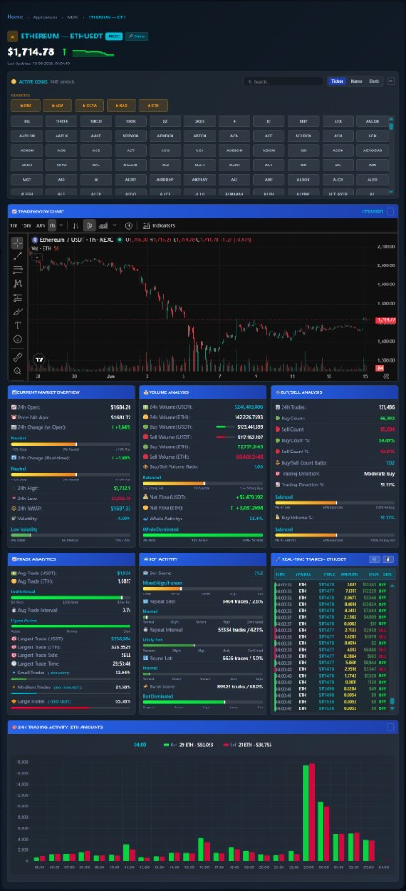

A useful market page should connect the latest price with what is happening around it. MEXC Live Statistics combines charts, trade activity and market analytics with a searchable coin catalogue, giving visitors one place to explore a market and operators one place to maintain its publication.

## Tech stack

| Layer | Technologies |
|---|---|
| Application | PHP, WordPress |
| Supporting technologies | HTML, CSS, JavaScript; MEXC; TradingView; WebSockets |

## Choose the market to explore

Coin navigation and market headers help visitors find a pair and retain the context of their selection. Favourites and catalogue controls make repeated visits more convenient. The experience is designed for moving between markets rather than treating every page as a separate tool.

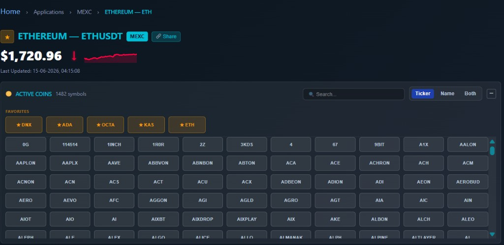

## Connect price with trading context

The chart and market panels bring price movement together with daily information. Trade analytics, the live tape and activity views help examine how that movement is being traded. Each panel adds a different perspective to the same market.

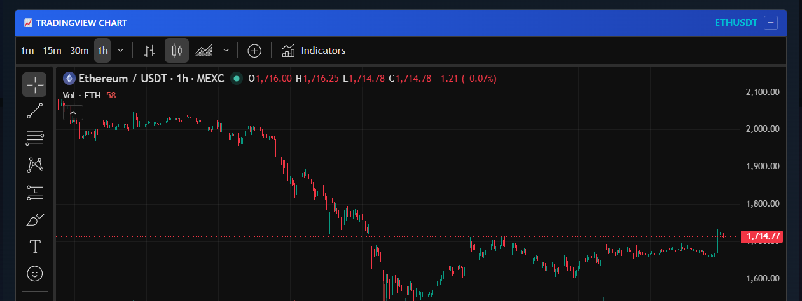

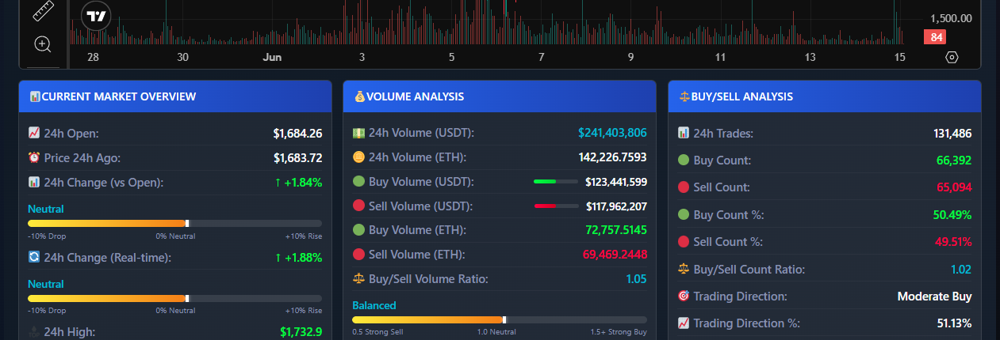

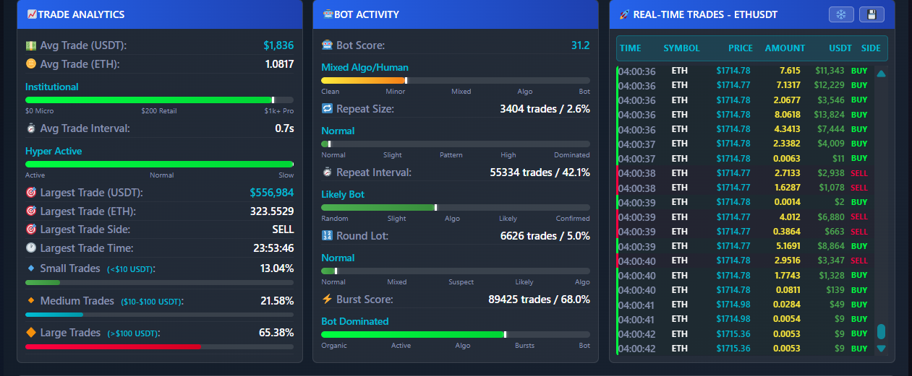

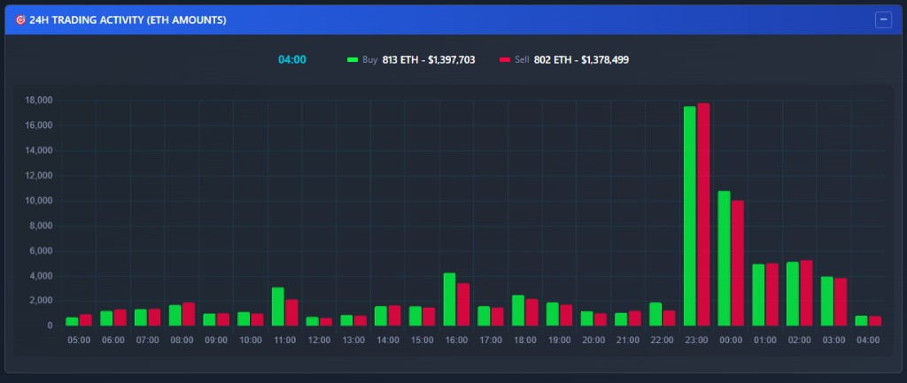

## Keep the market catalogue useful

Coin Manager supports reviewing, adding, reloading and maintaining tracked entries. Overview and activity information make maintenance easier to follow, including handling markets that are no longer useful. This gives the site owner a working catalogue rather than a static list.

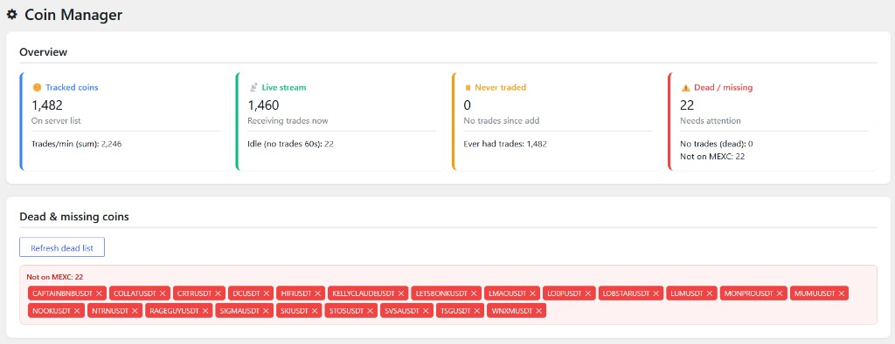

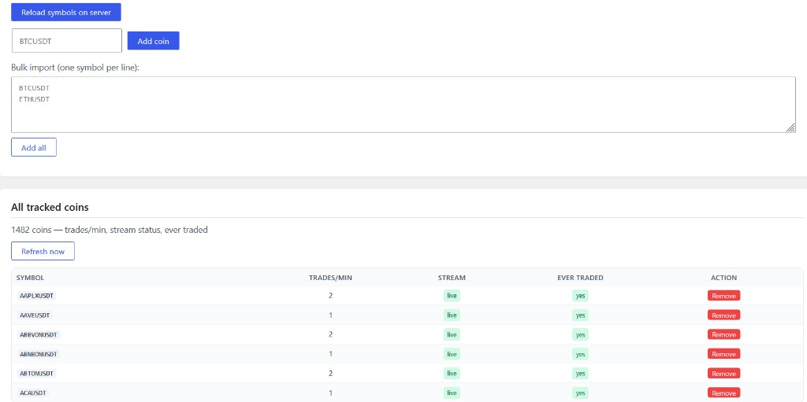

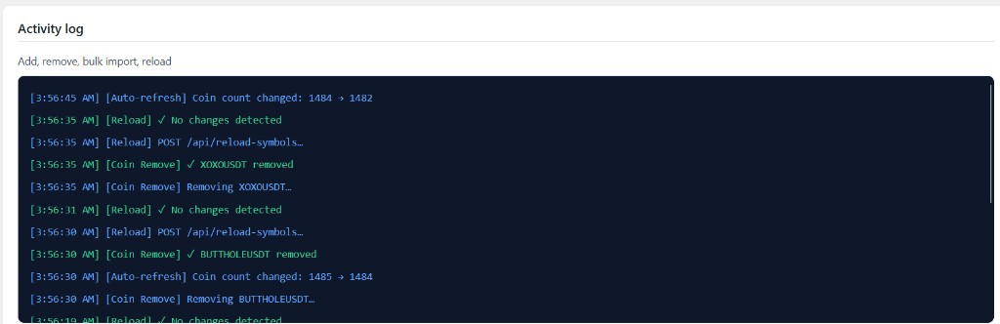

## Monitor the publishing experience

Connection monitoring, server metrics and logs help the operator investigate a stalled or incomplete market view. Having those checks close to catalogue management shortens routine support work. Visitors benefit from an operator who can find the relevant issue quickly.

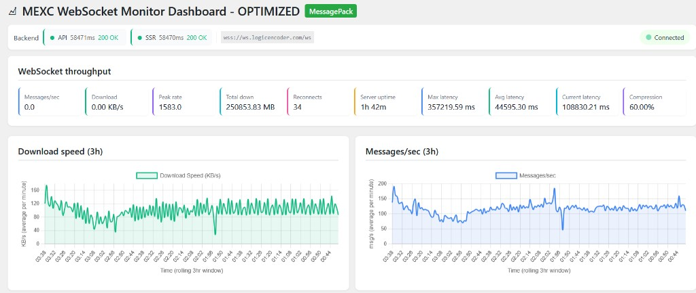

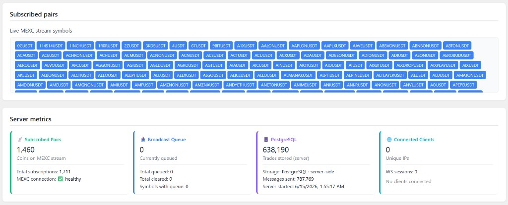

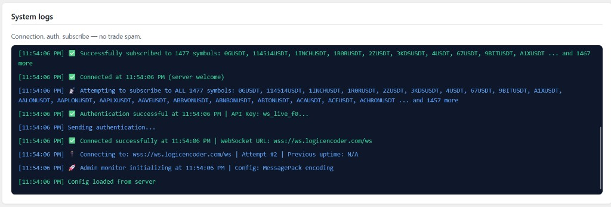

## Support discovery and presentation

Structured-data checks, sitemap management and indexing controls support publishing the market pages as part of a wider site. These are operator capabilities, with the implementation kept in private documentation. The existing image set is extensive; a more readable desktop hero would improve the first impression.

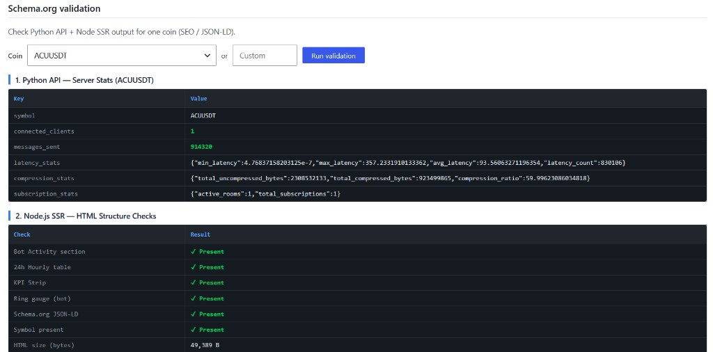

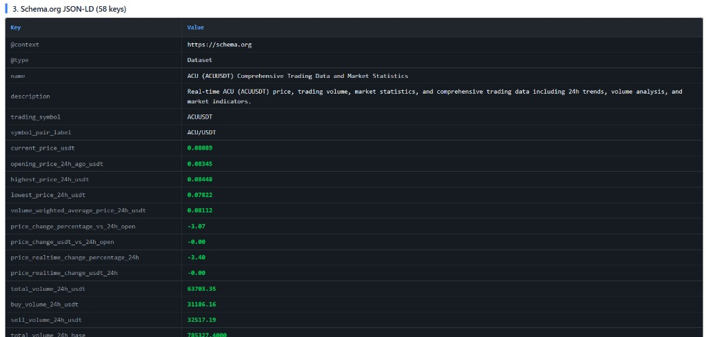

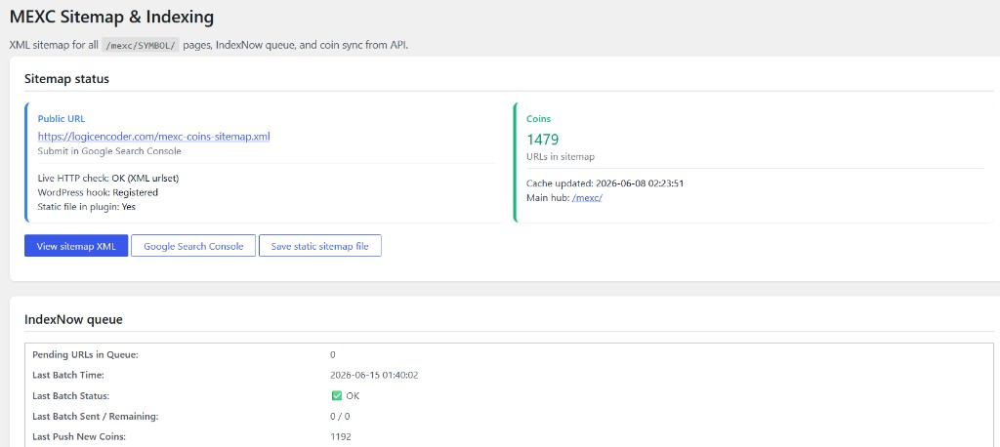

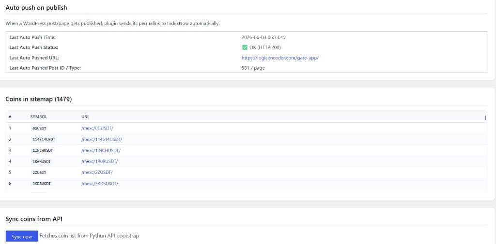

---

Private code: [mexc-live-stats-plugin](https://github.com/logicencoder/mexc-live-stats-plugin)

See [REPOS.md](REPOS.md) for related repositories.

**[Logic Encoder](https://logicencoder.com)** · [GitHub](https://github.com/logicencoder) · [Contact](https://logicencoder.com/contact/)
