# MEXC Live Statistics

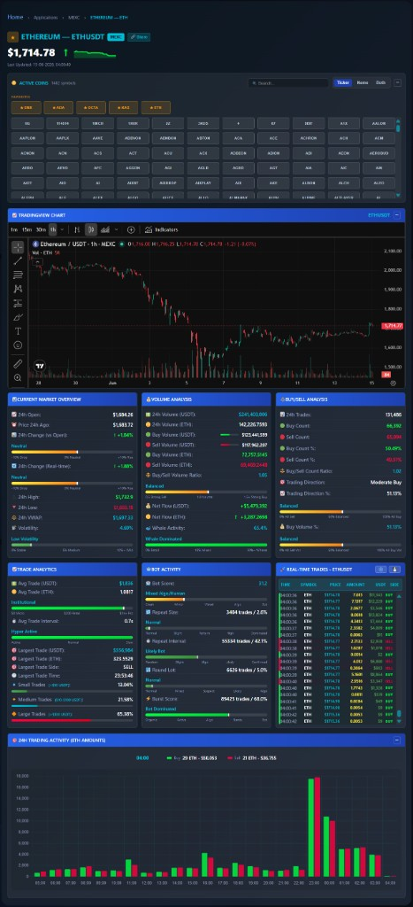

MEXC Live Statistics is a real-time dashboard for MEXC spot markets, published on [logicencoder.com](https://logicencoder.com). A visitor picks a coin and sees its price, 24-hour statistics, volume and buy/sell balance, a stream of recent trades and detected bot activity, all updated live over a WebSocket connection. The site operator gets a Coin Manager, connection monitoring and the search-engine tooling to publish each coin as its own page.

## Tech stack

| Layer | Technologies |
|---|---|
| Application | PHP, WordPress |
| Supporting technologies | HTML, CSS, JavaScript; MEXC public market data; WebSockets; optional TradingView chart (off by default) |

## Choose the market to explore

Visitors pick a pair from the coin catalogue; the market header keeps the selected pair and its context visible. Favourites mark the pairs you return to (the number of favourites is limited by a setting, and the limit is stored in the browser, so favourites are personal to the device). The catalogue gives the broad scan, the per-coin view answers a focused question, and a shareable address per coin returns to the same pair.

The catalogue supports a broad scan of the available markets, while the per-coin view supports a focused question. Returning to a familiar pair keeps that research routine easy to resume.

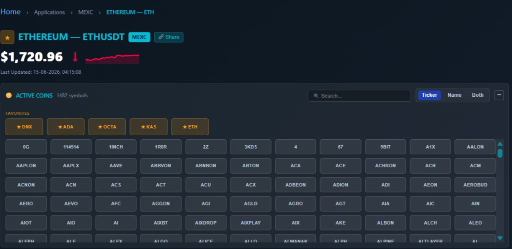

## Connect price with trading context

One coin page combines several panels that all follow the selected pair live: **Current Market Overview** (price and 24-hour figures), **Volume Analysis**, **Buy/Sell Analysis** (how trading splits between buyers and sellers), **Trade Analytics**, **Bot Activity** and a live tape of recent trades. An embedded TradingView chart is available as an option that the operator switches on in the settings; it is off by default, and while it is off the page makes no request to TradingView at all. When enabled it loads when opened and unloads when collapsed.

The chart, market panels and recent activity describe different aspects of the same pair. Their shared context helps visitors examine a movement without collecting the information across several pages.

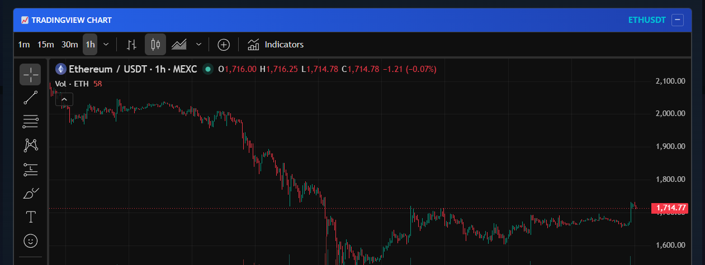

Market panels keep the selected pair's daily information together. They complement the chart with measures that help explain the scale and balance of observed trading.

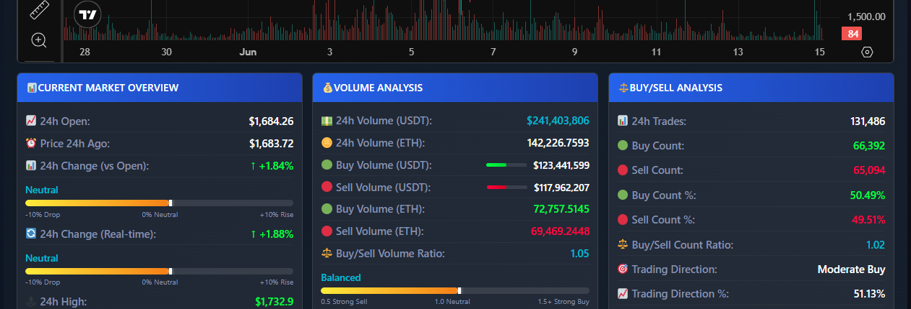

The analytics and tape view brings recent activity closer to the selected market. It is useful when a price movement calls for a closer look at the observations behind it.

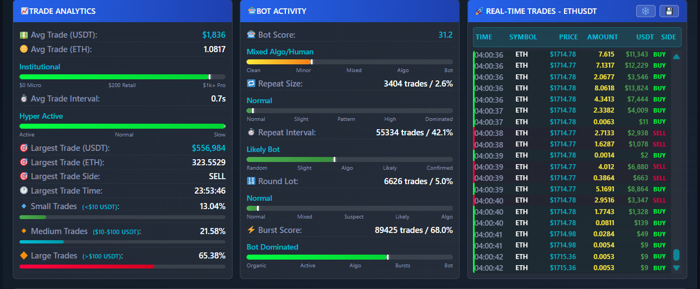

The daily activity view makes it easier to review how the selected market's session developed. Read it alongside the headline statistics and the period being examined.

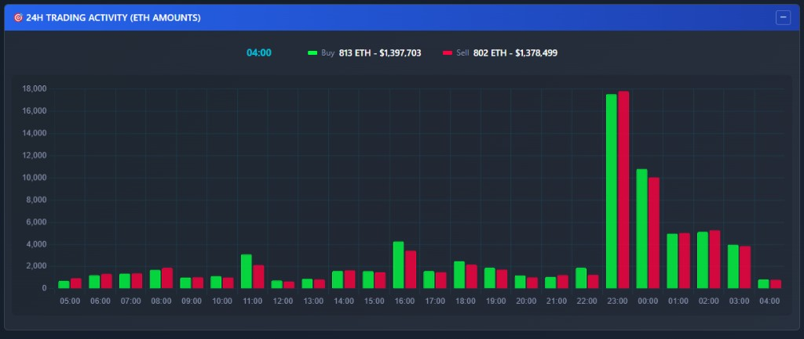

## Keep the market catalogue useful

The Coin Manager is the operator's catalogue workspace. Its Overview summarises the tracked set, **Dead & missing coins** lists pairs that stopped trading or never returned data, **Add & reload** adds a pair or reloads the list from the exchange, **All tracked coins** shows the full collection, and the **Activity log** records what changed. The refresh interval of the manager is configurable.

Catalogue administration keeps the markets offered to visitors connected to the ones being followed. Review the tracked selection and activity before deciding which entries need maintenance.

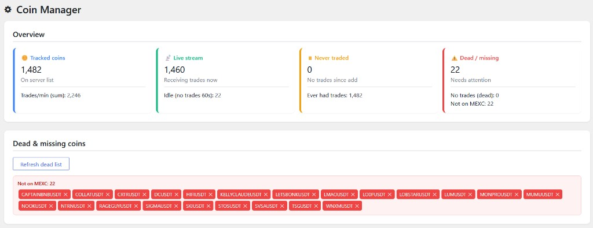

The tracked-market view focuses on the collection currently offered by the service. Review it when a market needs to be included, revisited or checked for availability.

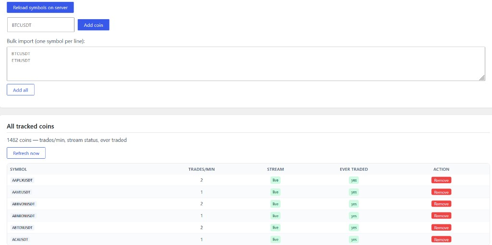

Catalogue activity records help the operator follow what changed during maintenance. They provide context when the public selection differs from what was expected.

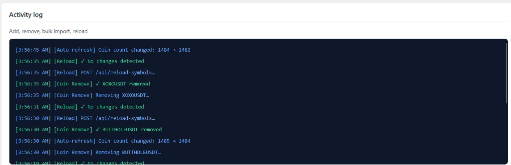

## Monitor the publishing experience

The monitoring area shows the live health of the data connection: WebSocket throughput, download speed and messages per second over the last three hours, the number of subscribed pairs, server metrics and system logs. Open it first when a coin page looks stalled: the throughput and subscription figures show whether data is still arriving, and the logs show why not.

Connection and server views help explain a publishing interruption. Operators can inspect the current state and relevant logs while the visitor-facing pages remain focused on market information.

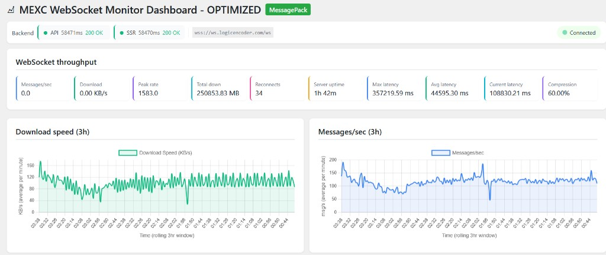

Server metrics provide the operating context behind the published markets. Review them when the visitor-facing information appears interrupted or out of date.

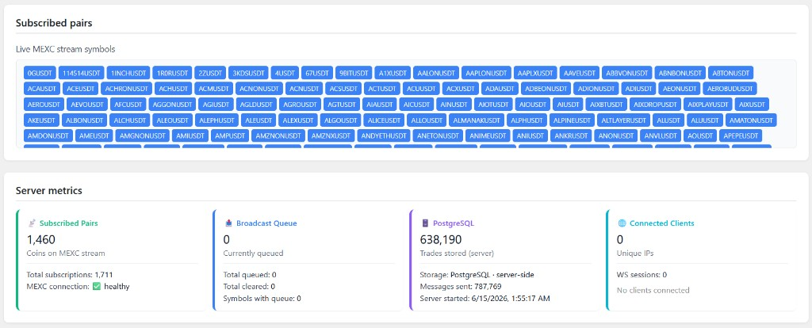

System logs support the next stage of an investigation when a status indicator is insufficient. They keep the relevant operating events accessible from the same administration workspace.

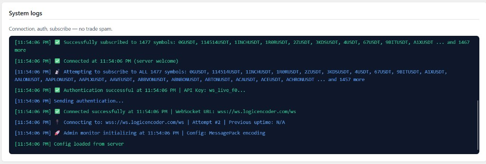

## Support discovery and presentation

Every coin can be published as a server-rendered HTML page with Schema.org structured data, so search engines see the content without running JavaScript. The SSR HTML & Schema.org validation screen checks a page and reports the result. The sitemap tools show the sitemap status, can include snapshot pages and chart images, update automatically, and sync the coin list from the data service; an IndexNow queue pushes new or changed pages to participating search engines, automatically on publish or by manual submission.

Search and presentation tools support making the market pages useful beyond an already-open dashboard. Review the published page and its discovery information together when maintaining the catalogue.

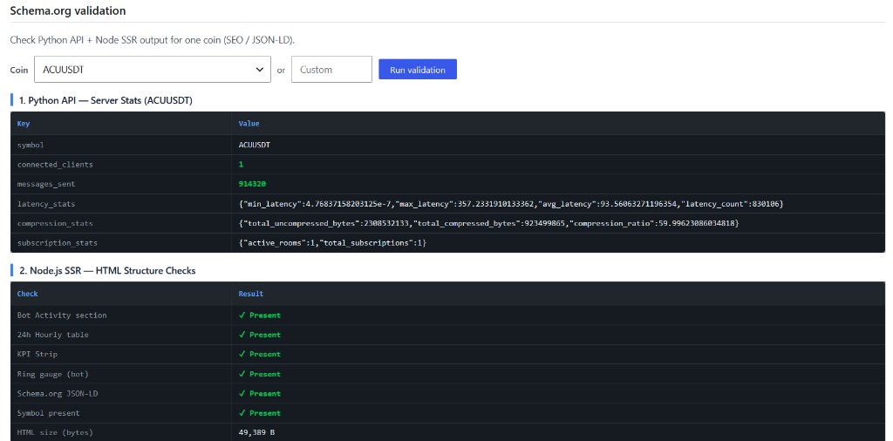

Structured discovery information supports how a market page is presented to search and related consumers. The operator can inspect that information alongside the page it describes.

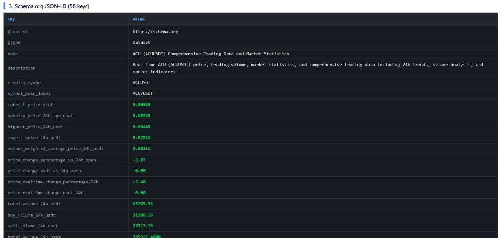

Sitemap and indexing tools connect the market catalogue with site discovery. They help the owner review how the published collection is offered beyond the dashboard itself.

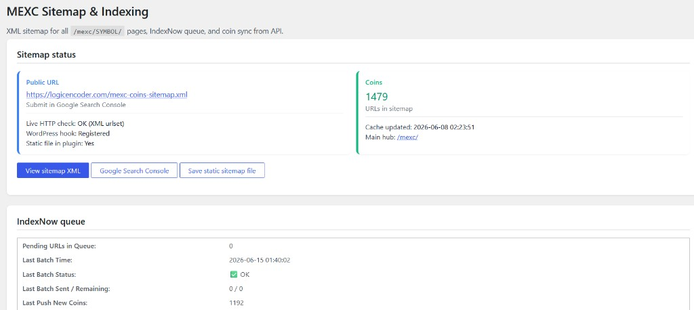

Catalogue synchronisation keeps discovery choices connected to the markets being published. Review the selection when listings change so the site remains coherent.

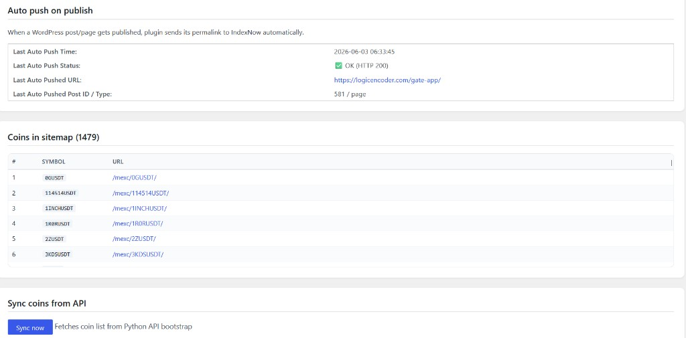

---

Private code: [mexc-live-stats-plugin](https://github.com/logicencoder/mexc-live-stats-plugin)

See [REPOS.md](REPOS.md) for related repositories.

**[Logic Encoder](https://logicencoder.com)** · [GitHub](https://github.com/logicencoder) · [Contact](https://logicencoder.com/contact/)
